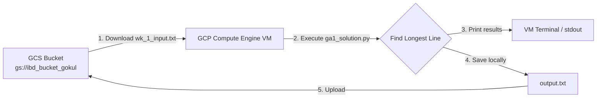

# Graded Assignment 1 (Week 2) - Introduction to Big Data

## 1. Overview
This project implements the solution for **Graded Assignment 1 (Week 2)** of the *Introduction to Big Data* course. 

The objective of this assignment is to:
- Connect to Google Cloud Storage (GCS) from a Google Cloud Platform (GCP) Compute Engine VM.
- Download an input text file stored in a GCS bucket (`gs://ibd_bucket_gokul/wk_1_input.txt`).
- Process the text file to determine the longest line(s) based on character length.
- Print the analysis results to the terminal.
- Save the results into an output file and upload it back to the GCS bucket (`gs://ibd_bucket_gokul/output.txt`).

---

## 2. Included Files and Their Utility

| File Name | File Type | Utility & Description |
| :--- | :--- | :--- |
| **`ga1_solution.py`** | Python Script (`.py`) | Main execution script. Automates the full data pipeline: authenticates with GCP using the GCS Python client library, downloads the input file from the GCS bucket, processes line lengths while handling ties, formats the results, prints them to standard output, saves them locally, and uploads the generated `output.txt` back to the GCS bucket. |
| **`output.txt`** | Text Output (`.txt`) | The final artifact generated by `ga1_solution.py` and retrieved from the GCS bucket (`gs://ibd_bucket_gokul/output.txt`). Contains the total lines analyzed, maximum character length, and the verbatim longest line(s) along with line numbers. |
| **`README.md`** | Markdown Documentation (`.md`) | Documentation explaining the purpose and utility of each file included in the submission package, environment prerequisites, architecture flow, and execution instructions. |

---

## 3. Architecture & Execution Flow



---

## 4. Environment & Dependencies

- **Platform:** GCP Compute Engine VM (Debian / Linux)
- **Python Version:** Python 3.10+
- **Required Libraries:**
  - `google-cloud-storage`

To install the required dependency on the VM:
```bash
pip install google-cloud-storage
```

---

## 5. Execution Instructions

1. **Authenticate on the VM (if not using VM Service Account scopes):**
   ```bash
   gcloud auth application-default login --no-launch-browser
   ```

2. **Run the script:**
   ```bash
   python3 ga1_solution.py
   ```
   *Optional parameters:*
   ```bash
   python3 ga1_solution.py --bucket ibd_bucket_gokul --input-blob wk_1_input.txt --output-blob output.txt
   ```

3. **Verify/Download the output file from GCS:**
   ```bash
   gsutil cp gs://ibd_bucket_gokul/output.txt .
   ```

---

## 6. Execution Output Summary
From the execution on the input dataset:
- **Total Lines Scanned:** 9
- **Maximum Line Length:** 204 characters
- **Matching Line:** Line 9 (`- Write a Python program that downloads the test file from GCS Bucket, finds the longest line(s) in the file (based on character length), prints the results in terminal and saves the output in GCS Bucket.`)
