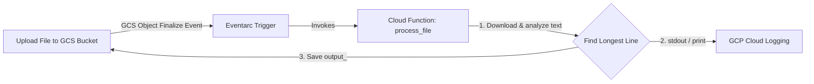

Analyzed ga2.md:L1-30
Analyzed 1.1.md:L1-39
Analyzed 1.2.md:L1-32
Ran list files in GA2 directory
Analyzed main.py:L1-100
Analyzed Readmd.md:L1-4
Analyzed 1.md:L1-73
Analyzed demo.md:L1
Analyzed 1.3.md:L1-15
Analyzed 1.4.md:L1-32
Analyzed 1.5.md:L1-20
Analyzed 1.6.md:L1-26
Analyzed 1.7.md:L1-27

Here is the complete, step-by-step walkthrough to complete **Graded Assignment 2 (Week 3)**.

---

### 1. High-Level Architecture & Concept

In GA1, you ran a script manually on a VM. In GA2, the process is automated using an **event-driven Cloud Function (Gen 2)**:



> [!IMPORTANT]
> **Infinite Loop Prevention:** Because the function uploads an output file back to the *same* bucket, the code explicitly checks `if file_name.startswith("output_"): return` so it does not trigger itself in an endless loop.

---

### 2. Required Files

The implementation files are already created in your repo:
- [main.py](file:///d:/gokul_repos/iitm/Intro-to-big-data/Sept_2026/week3/GA2/main.py)
- [requirements.txt](file:///d:/gokul_repos/iitm/Intro-to-big-data/Sept_2026/week3/GA2/requirements.txt)

#### `requirements.txt`
```text
functions-framework==3.*
google-cloud-storage==2.*
```

#### `main.py` (Core Logic Overview)
Uses `@functions_framework.cloud_event` to receive the bucket and file name from the event payload:
```python
@functions_framework.cloud_event
def process_file(cloud_event):
    data = cloud_event.data
    bucket_name = data["bucket"]
    file_name = data["name"]

    if file_name.startswith("output_"):
        return

    # Download from GCS
    storage_client = storage.Client()
    blob = storage_client.bucket(bucket_name).blob(file_name)
    content = blob.download_as_text(encoding="utf-8")

    # Find longest lines and format
    max_len, longest_lines, total_lines = find_longest_lines(content)
    formatted_output = format_results(...)

    # Print to Cloud Logging
    print(formatted_output)

    # Save output_<filename> to the same bucket
    out_blob = storage_client.bucket(bucket_name).blob(f"output_{file_name}")
    out_blob.upload_from_string(formatted_output, content_type="text/plain")
```

---

### 3. Step-by-Step Deployment on GCP (Cloud Shell)

Open **Google Cloud Shell** in your project console:

#### Step 3.1: Set Project Variables & IAM Permissions
Eventarc needs permission to monitor bucket events. Replace `PROJECT_ID` with your project ID:

```bash
PROJECT_ID=$(gcloud config get-value project)
PROJECT_NUMBER=$(gcloud projects describe $PROJECT_ID --format='value(projectNumber)')

# Grant Pub/Sub publisher to GCS service agent
gcloud projects add-iam-policy-binding $PROJECT_ID \
  --member="serviceAccount:service-${PROJECT_NUMBER}@gs-project-accounts.iam.gserviceaccount.com" \
  --role="roles/pubsub.publisher"

# Grant Eventarc event receiver to Compute service account
gcloud projects add-iam-policy-binding $PROJECT_ID \
  --member="serviceAccount:${PROJECT_NUMBER}-compute@developer.gserviceaccount.com" \
  --role="roles/eventarc.eventReceiver"
```

#### Step 3.2: Deploy the Cloud Function
Navigate to your folder containing `main.py` and `requirements.txt`, then run:

```bash
gcloud functions deploy process_file \
  --gen2 \
  --runtime python312 \
  --region us-central1 \
  --source . \
  --entry-point process_file \
  --trigger-location us \
  --trigger-event-filters="type=google.cloud.storage.object.v1.finalized" \
  --trigger-event-filters="bucket=gokul_ibd_bucket" \
  --allow-unauthenticated
```
*(Note: `--trigger-location us` matches the multi-region of your bucket `gokul_ibd_bucket`)*

---

### 4. Testing & Verification

#### Step 4.1: Upload a File to Trigger the Function
Upload a test text file into your bucket:
```bash
gcloud storage cp input.txt gs://gokul_ibd_bucket/input.txt
```

#### Step 4.2: Check Logs in Cloud Logging
Wait ~30 seconds for the trigger to execute, then view the logs:
```bash
gcloud functions logs read process_file --gen2 --region us-central1 --limit 50
```
Or open **GCP Console → Logs Explorer** and filter by:
```text
resource.type="cloud_run_revision"
resource.labels.service_name="process-file"
```
You will see the block:
```text
============================================================
              LONGEST LINE ANALYSIS RESULTS
============================================================
...
```

#### Step 4.3: Verify and Download the Output File
Confirm the result file was generated in the bucket:
```bash
gcloud storage ls gs://gokul_ibd_bucket/output_*
gcloud storage cp gs://gokul_ibd_bucket/output_input.txt .
cat output_input.txt
```

---

### 5. Final Submission Checklist

1. **Python Code:** [main.py](file:///d:/gokul_repos/iitm/Intro-to-big-data/Sept_2026/week3/GA2/submission/main.py)
2. **Output File:** Downloaded `output_*.txt` from GCS
3. **Screenshot:** Logs Explorer showing the printed `LONGEST LINE ANALYSIS RESULTS`
4. **Screencast Video (5–10 min with audio):**
   - Explain the Cloud Function code & GCS trigger event
   - Show the deployed function in the GCP Console
   - Upload `input.txt` to GCS live to trigger execution
   - Show the logs in Logs Explorer and the generated output file in GCS