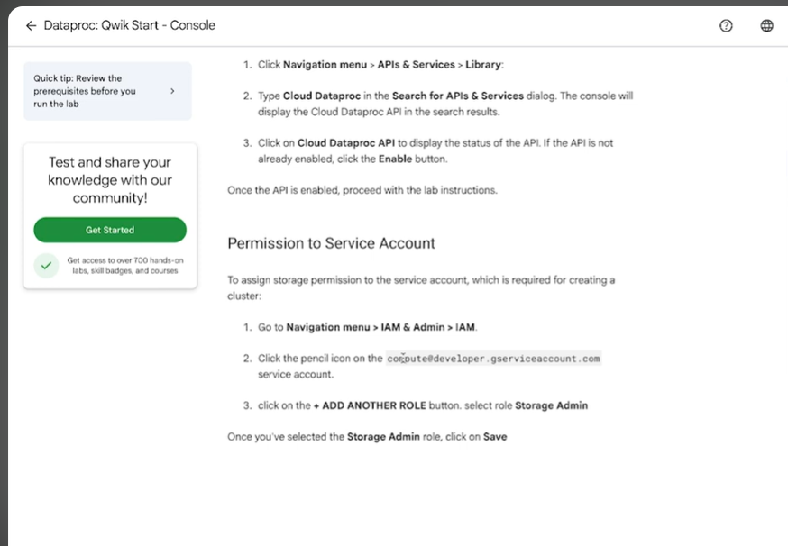
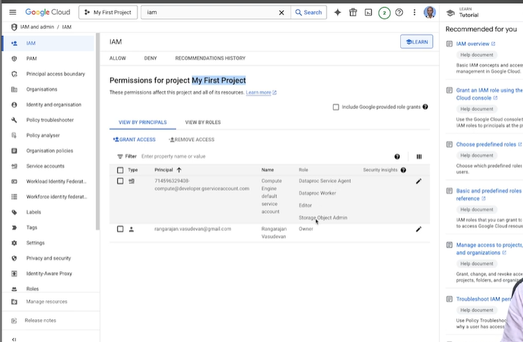

### W4_L6: Hands-on creating a dataproc cluster

- https://youtu.be/ym8uaSoZX9w

- Week 4: How to run a Spark job in Dataproc: https://www.cloudskillsboost.google/focuses/586?catalog_rank=%7B%22rank%22%3A1%2C%22num_filters%22%3A0%2C%22has_search%22%3Atrue%7D&parent=catalog&search_id=32020937 
    - the above is from resources

- 

- IAM means -> identity and access management

- 
- we want `DataProc Service Agent` , `Dataproc Worker` and `Storage Object Admin`

- After these roles -> go to DataProc interface

## NOTE: Dataproc is now Managed  Apache Spark
```

Spark? Consider it managed.
Starting today, `Dataproc` is now `Managed Service for Apache Spark`. With Managed Service for Apache Spark, you'll have the same access to clusters, components, and serverless environments to manage your workloads, but with clearer guidance around the Spark backbone of your workflow. With Managed Service for Apache Spark, you can develop, debug, and troubleshoot Spark code faster using Gemini and agentic workflows.
```

- enable this api too 
  - https://console.developers.google.com/apis/api/cloudresourcemanager.googleapis.com/overview?project=137496575726

- Create a dataproc cluster
```bash
gcloud dataproc clusters create gokul-s-dataproc-cluster \
  --project project-77971f5c-a874-479a-a6c \
  --region asia-south1 \
  --single-node \
  --master-machine-type e2-standard-2 \
  --master-boot-disk-size 50GB \
  --max-idle 60m \
  --bucket AAPKA_BUCKET \
  --optional-components JUPYTER
```


- machine type: n2-standard-4 
- Primary disk size : 100GB
- Internal IP only - No
- Optional Component : Jupyter

- n2 vs e2
    - E2 built for low-cost efficiency and
    -  N2 built for high, predictable performance


- How to ssh into the dataproc cluster

- `gcloud compute instances list --project=project-77971f5c-a874-479a-a6c`

```
gcloud compute ssh gokul-s-dataproc-cluster-m     --zone=asia-south1-c     --tunnel-through-iap     --project=project-77971f5c-a874-479a-a6c
```

- https://github.com/garystafford/dataproc-python-demo